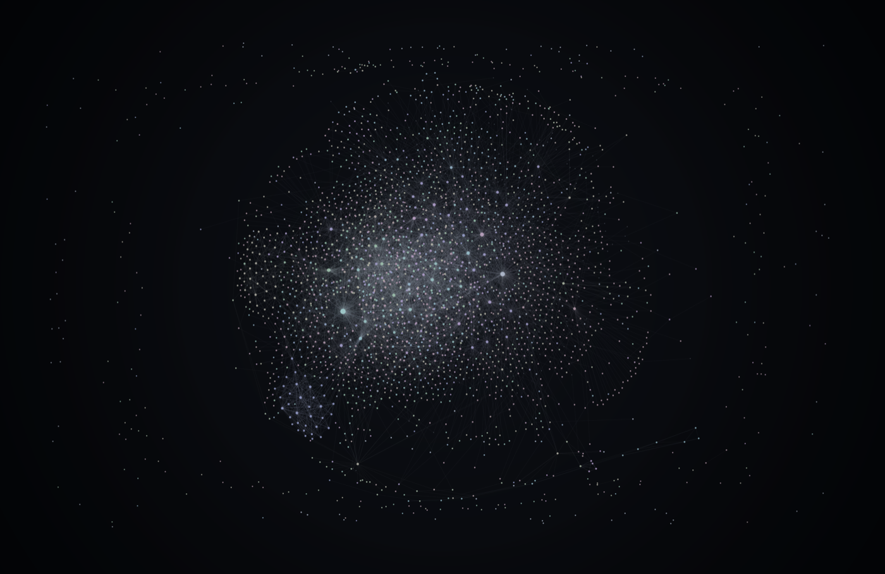

# Vault Wallpaper

Your Obsidian vault's graph as your Mac's desktop wallpaper. Every note is a point, every
link a line, and the picture updates as you write. It's a small native app that lives in
the menu bar: no browser, no Node, no local server, no wallpaper host app.


**Status: 1.0 beta.** macOS 13 Ventura or later, Apple Silicon or Intel.

## Install

### From the DMG

1. Download `Vault-Wallpaper-<version>.dmg` from
   [Releases](https://github.com/william-ricchiuti/vault-wallpaper/releases).
2. Open it and drag **Vault Wallpaper** to **Applications**.
3. Open Vault Wallpaper from Applications. A small graph icon (three linked dots) appears in
   the menu bar. The app has no Dock icon.

### With Homebrew

Homebrew 7 and later only load casks from other people's taps once you trust them, so the
first command does that for this one cask:

```bash
brew trust --cask william-ricchiuti/tap/vault-wallpaper
brew install --cask william-ricchiuti/tap/vault-wallpaper
```

Updates come from the app itself (Check for Updates…), so `brew upgrade` leaves it alone.

## First run

The first time it opens, Vault Wallpaper asks you to choose your Obsidian vault (the folder
that holds your notes). It reads the vault, lays out the graph and draws it behind your
desktop icons, on every Space and every display. The layout is cached, so later launches
don't have to lay it out again.

New installs start still: the picture only changes when your notes do. Motion (glow that
breathes, edit effects) is opt-in in Settings.

If the vault folder isn't there (an unplugged drive, a folder that was moved), the menu's top
line says **Vault not found** and the app looks for it again when a drive is mounted and every
minute until it's back.

**iCloud Drive vaults:** with *Optimize Mac Storage* on, macOS may move notes you haven't opened
in a while to iCloud, leaving `.Note.md.icloud` placeholders. Vault Wallpaper doesn't download
files, so those notes aren't shown until they're downloaded again. To keep the whole vault on
your Mac, right-click the vault folder in Finder and choose **Keep Downloaded** (macOS 15 and
later), or turn off *Optimize Mac Storage* in System Settings → Apple Account → iCloud →
iCloud Drive.

Used the web version (obsidian-live-wallpaper)? Choose **Import Web Version Settings…** in the
menu to bring your old `config.json` and custom presets over. See
[Migrating from the web version](docs/migrating-from-web.md).

## The menu

| Item | What it does |
|---|---|
| Pause Wallpaper | Freezes the picture (no animation) until you untick it. |
| Settings… | Themes, presets, colours, labels, layout and motion. Changes apply as you make them. |
| Choose Vault… | Switch to another vault. |
| Import Web Version Settings… | Read a `config.json` from the web version. |
| Export PNG | Saves the current picture to `~/Pictures/Vault Wallpaper/` and shows it in Finder. With several displays, it saves the first display's picture. |
| Open Config File | Opens `config.json` in your text editor; edits apply when you save. |
| Start at Login | Opens Vault Wallpaper when you log in. |
| Check for Updates… | Looks for a newer version now (DMG and Homebrew installs; the App Store updates its own copy). |

## Themes

| Theme | Look |
|---|---|
| **Default** | The classic glowing graph. Presets (Neon, Blueprint, Parchment, Synthwave and more) tune its colours, glow and labels. |
| **Night Sky** | Notes as stars, your busiest notes as the brightest, tags as constellations. |
| **Aurora Lite** | Soft aurora curtains rising over your biggest tag clusters. |
| **Ink & Paper** | A printed plate: ink on warm paper. With motion on, saving a note makes its ink bleed for a moment. |
| **Pulse** | A calm, still graph on dark slate. With motion on, saving a note sends light out along its links, hop by hop, then everything is still again. |

| Night Sky | Aurora Lite | Ink & Paper | Pulse |
|---|---|---|---|
|  |  |  |  |

Pick a theme or preset in **Settings…**. You can save your own presets there too.

## Settings

Settings are stored in `~/Library/Application Support/Vault Wallpaper/config.json`, in the
same format the web version used, so you can also edit the file by hand. The app watches it
and applies changes when the file is saved. Invalid values are skipped (the rest of the file
still applies) and logged.

Notable settings: accent and background colours, tag colours, which folders to ignore
(`ignorePaths`), whether to show links to notes that don't exist yet
(`showUnresolvedLinks`), label size and source, layout (force, rings, timeline, galaxy),
and motion.

## Privacy

Everything stays on your Mac. Vault Wallpaper reads your vault's Markdown files to find notes,
links and tags, and never changes them. No analytics, no crash reports, no account.

The one network request: the DMG and Homebrew versions check for updates once a day, with
[Sparkle](https://sparkle-project.org). That is one small HTTPS request for a short
`appcast.xml` file on GitHub, which sends nothing about you or your vault beyond what any web
request carries (your IP address and the app's version in the user agent). Nothing else runs
in between. An update is downloaded only when there is one, and installed only after its
signature checks out. Turn the daily check off in the update window ("Automatically check
for updates") or with
`defaults write com.williamricchiuti.vaultwallpaper SUEnableAutomaticChecks -bool NO`; the
menu's Check for Updates… still works. The Mac App Store version has no updater and makes no
network requests.

Its own files are:

- `~/Library/Application Support/Vault Wallpaper/`: `config.json`, `custom-presets.json` and
  the cached layout (`layout.json`).
- `~/Pictures/Vault Wallpaper/`: PNGs you export.

## Light on your Mac

It draws only when something changes. With the wallpaper covered by windows, or still, it
draws nothing. Measured on 2026-11-07 (1.0 beta, M3 Pro, 3024×1964 Retina display): about a
52–55 MB memory footprint at idle. A redraw (a note edited, a setting or theme changed)
briefly uses more while the graphics driver works, then the app is back at its idle footprint
within a few seconds.

## Uninstall

Quit it from the menu, untick Start at Login first if you turned it on, and move the app to the
Bin. With Homebrew, `brew uninstall --cask vault-wallpaper` does both (`--zap` also removes
everything below).

To remove its settings and caches too, delete:

- `~/Library/Application Support/Vault Wallpaper/` (settings, layout cache, custom presets)
- `~/Library/Caches/com.williamricchiuti.vaultwallpaper/` (including the updater's downloads)
- `~/Library/Preferences/com.williamricchiuti.vaultwallpaper.plist` (update-check preferences)
- `~/Library/HTTPStorages/com.williamricchiuti.vaultwallpaper/`,
  `~/Library/WebKit/com.williamricchiuti.vaultwallpaper/` and
  `~/Library/Saved Application State/com.williamricchiuti.vaultwallpaper.savedState/`, if present

Images you exported in `~/Pictures/Vault Wallpaper/` are yours and stay.

Licences of the open-source code inside the app are in
[THIRD-PARTY-NOTICES.txt](THIRD-PARTY-NOTICES.txt), also shipped in the app
(`Contents/Resources`) and the DMG.

## Build from source

Needs Rust (rustup) and the Xcode command line tools.

```bash
cargo run --release -p vault-wallpaper -- --vault ~/path/to/vault   # run without bundling
packaging/build-app.sh                                              # dist/Vault Wallpaper.app (universal)
packaging/make-dmg.sh                                               # dist/Vault-Wallpaper-<version>.dmg
cargo test --workspace
```

`--front` shows the graph in a normal window instead of on the desktop. Signing,
notarization and the release steps are in [`packaging/README.md`](packaging/README.md) and
[`docs/release-checklist.md`](docs/release-checklist.md).

Repository layout: `crates/core` (vault reader, layout engine, config), `crates/render` (the
wgpu renderer and themes), `crates/app` (the macOS app: wallpaper windows, menu, settings
window), `packaging/` (bundle, DMG, signing, Homebrew cask draft), `docs/plan.md` (architecture
and roadmap).

## The web version

The original, browser-based version lives on at
[obsidian-live-wallpaper](https://github.com/william-ricchiuti/obsidian-live-wallpaper) and
still runs on Windows and Linux through wallpaper hosts like Lively.

## Licence

MIT. See [LICENSE](LICENSE).
